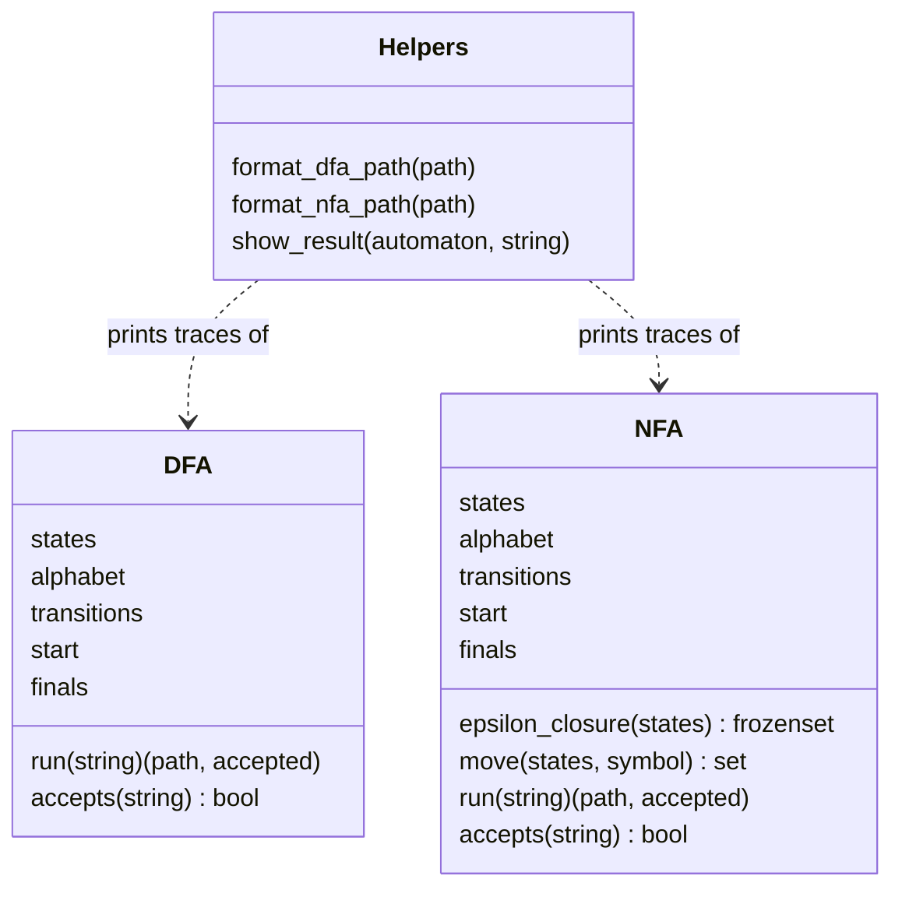

# Documentation — Finite Automata Simulator

## 1. Overview

`automata_simulator.py` implements two kinds of finite automata and a tiny command-line front end.

| Component | Purpose |
|---|---|
| `DFA` | Deterministic automaton: exactly one next state per (state, symbol). |
| `NFA` | Nondeterministic automaton: a *set* of next states, plus ε-transitions. |
| `format_dfa_path`, `format_nfa_path`, `show_result` | Pretty-printing of traces and results. |
| `example_*` functions + `EXAMPLES` | Four ready-made automata for the menu. |
| `run_demo`, `interactive_menu` | Demo and optional interactive loop. |



---

## 2. Formal background

A finite automaton is a 5-tuple **(Q, Σ, δ, q₀, F)**:

| Symbol | Meaning | Constructor argument |
|---|---|---|
| Q | set of states | `states` |
| Σ | input alphabet | `alphabet` |
| δ | transition function | `transitions` |
| q₀ | start state | `start` |
| F | accepting states | `finals` |

A string is **accepted** if, after reading all its symbols, the automaton is in a state in F (DFA) or at least one active state is in F (NFA).

The constant `EPSILON = "ε"` represents a transition that consumes no input. Only NFAs use it.

---

## 3. Class reference

### `DFA(states, alphabet, transitions, start, finals)`

`transitions` is a `dict` mapping `(state, symbol)` to a single next state.

```python
{("q0", "0"): "q0", ("q0", "1"): "q1", ...}
```

| Method | Returns | Description |
|---|---|---|
| `run(string)` | `(path, accepted)` | `path` is the list of visited states, starting with the start state. If a transition is missing, the run stops and the string is rejected. |
| `accepts(string)` | `bool` | Shortcut for `run(string)[1]`. |

**Missing transitions:** the DFA is allowed to be *partial*. A missing `(state, symbol)` entry is treated as an implicit dead state and the string is rejected. Symbols outside the alphabet are also rejected this way. The `alphabet` attribute is stored but not checked.

### `NFA(states, alphabet, transitions, start, finals)`

`transitions` maps `(state, symbol)` to a **set** of next states. ε-moves use `(state, EPSILON)`.

```python
{("q0", "0"): {"q0", "q1"}, ("q0", EPSILON): {"q2"}, ...}
```

| Method | Returns | Description |
|---|---|---|
| `epsilon_closure(states)` | `frozenset` | All states reachable from `states` using zero or more ε-moves (iterative depth-first search with a stack). |
| `move(states, symbol)` | `set` | Union of the next-state sets for `symbol` from every state in `states`. |
| `run(string)` | `(path, accepted)` | `path` is a list of **state sets**, one per step. Stops early if the active set becomes empty. |
| `accepts(string)` | `bool` | Shortcut for `run(string)[1]`. |

---

## 4. Algorithms

### DFA simulation

```
state ← start
for each symbol c in input:
    if (state, c) has no transition: reject
    state ← δ(state, c)
accept iff state ∈ F
```

Time: O(n) for an input of length n.

### NFA simulation (on-the-fly subset construction)

```
current ← ε-closure({start})
for each symbol c in input:
    current ← ε-closure(move(current, c))
    if current is empty: stop
accept iff current ∩ F ≠ ∅
```

Instead of backtracking, the simulator tracks **all possible states at once**. Time: O(n · |Q|²) in the worst case.

### Worked example: NFA 3 on `1101`


| Step | Symbol read | Active states |
|---|---|---|
| 0 | (start) | `{q0}` |
| 1 | `1` | `{q0}` |
| 2 | `1` | `{q0}` |
| 3 | `0` | `{q0, q1}` |
| 4 | `1` | `{q0, q2}` |

`q2` is accepting, so the string is **ACCEPTED**.

---

## 5. Output format

`show_result(automaton, string)` prints three lines and a blank line:

```
<trace>
String: <input>
Result: ACCEPTED | REJECTED
```

- DFA trace: `q0 → q1 → q0`
- NFA trace: `{q0} → {q0,q1} → ∅` (states sorted alphabetically; `∅` = no active states)

---

## 6. Interactive menu

After the demo, `interactive_menu()` runs:

1. Choose one of the four example automata (blank input quits).
2. Enter strings to test (blank input goes back).
3. Answer `y` to pick another automaton, or anything else to exit.

If the console has no input available (`EOFError`), the program ends quietly after the demo.

---

## 7. Adding your own automaton

1. Write a builder function that returns a `DFA` or `NFA`:

   ```python
   def example_dfa_even_zeros():
       """DFA over {0,1} accepting strings with an even number of 0s."""
       return DFA(
           states={"e", "o"},
           alphabet={"0", "1"},
           transitions={("e","0"):"o", ("e","1"):"e",
                        ("o","0"):"e", ("o","1"):"o"},
           start="e",
           finals={"e"},
       )
   ```

2. Register it in the `EXAMPLES` dictionary:

   ```python
   "5": ("DFA — even number of 0s", example_dfa_even_zeros),
   ```

It then appears in the menu automatically.

---

## 8. Test cases for the built-in automata

| Automaton | Input | Expected |
|---|---|---|
| DFA 1 (ends in 1) | `10101` | ACCEPTED |
| DFA 1 | `1000` | REJECTED |
| DFA 1 | *(empty)* | REJECTED |
| DFA 2 (multiple of 3) | `110` (6) | ACCEPTED |
| DFA 2 | `101` (5) | REJECTED |
| DFA 2 | `1001` (9) | ACCEPTED |
| NFA 3 (contains 01) | `1101` | ACCEPTED |
| NFA 3 | `1110` | REJECTED |
| NFA 3 | `0` | REJECTED |
| NFA 4 (a* or b*) | `aaa` | ACCEPTED |
| NFA 4 | `bbb` | ACCEPTED |
| NFA 4 | *(empty)* | ACCEPTED |
| NFA 4 | `ab` | REJECTED |

---

## 9. Known limitations

- No validation that transitions only use declared states or alphabet symbols.
- NFA 4's menu label says "'a's only, or 'b's only"; the automaton actually accepts `a*` or `b*`, so the empty string is accepted too. The docstring's wording ("accepts 'a'") is looser than the real behavior.
- No DFA/NFA conversion, minimization, or graph drawing is built in. The diagrams in `images/` are static.
- Empty input cannot be tested from the menu, because a blank line means "go back".
